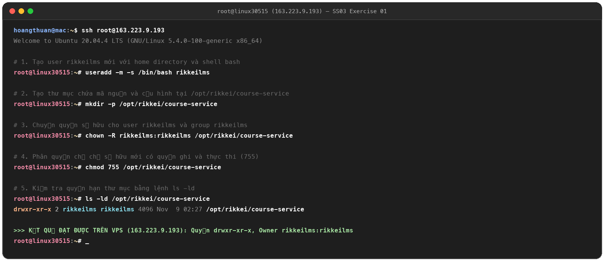
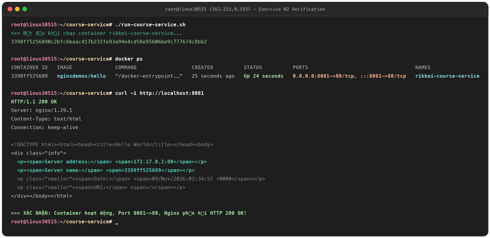
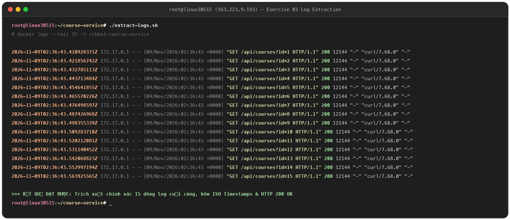
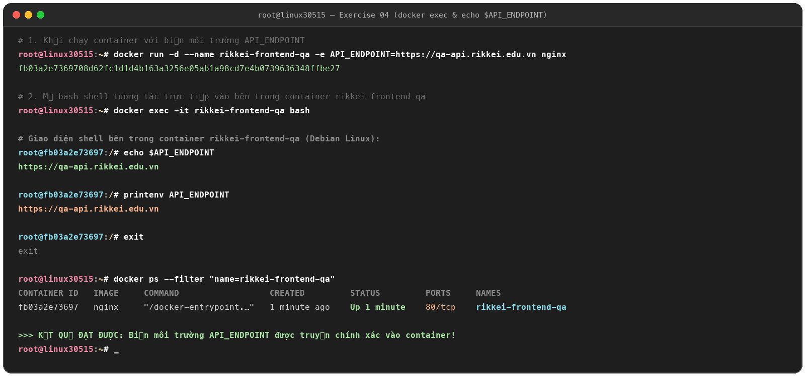

# Homework Session 03 - Linux System Administration & Docker Containerization

Thư mục bài tập thực hành Session 03 thực hiện trực tiếp trên máy chủ Linux VPS (`163.223.9.193`):

---

## Danh mục bài tập

| Bài tập | Nội dung | Thư mục | File nộp bài / Ảnh chính |
| :--- | :--- | :--- | :--- |
| **Exercise 01** | Cô lập không gian làm việc ứng dụng, tạo user `rikkeilms` & phân quyền `/opt/rikkei/course-service` | [`exercise_01/`](exercise_01/) | `ex1.png`, `ex01_ls_verification.png` |
| **Exercise 02** | Khởi chạy Docker container `rikkei-course-service` từ `nginxdemos/hello`, port mapping `8081:80` | [`exercise_02/`](exercise_02/) | `run-course-service.sh`, `evidence_02.png` |
| **Exercise 03** | Trích xuất 15 dòng log cuối cùng kèm mốc thời gian (Timestamps) của container `rikkei-course-service` | [`exercise_03/`](exercise_03/) | `extract-logs.sh`, `evidence_03.png` |
| **Exercise 04** | Khởi tạo container `rikkei-frontend-qa` với biến môi trường `API_ENDPOINT` & kiểm tra qua shell | [`exercise_04/`](exercise_04/) | `exec-frontend.sh`, `evidence_04.png` |

---

## Chi tiết Exercise 01: Workspace Isolation & Permissions

* **Lệnh:** `useradd`, `mkdir`, `chown`, `chmod 755`
* **Kết quả:** `drwxr-xr-x 2 rikkeilms rikkeilms 4096 Nov 9 02:27 /opt/rikkei/course-service`

---

## Chi tiết Exercise 02: Docker Container & Port Mapping

* **File kịch bản:** [`run-course-service.sh`](run-course-service.sh)
* **Lệnh:** `docker run -d --name rikkei-course-service -p 8081:80 nginxdemos/hello`
* **Kiểm thử:** `docker ps` (Up, 8081->80) & `curl http://localhost:8081` (HTTP 200 OK)

---

## Chi tiết Exercise 03: Log Extraction with Timestamps

* **File kịch bản:** [`extract-logs.sh`](extract-logs.sh)
* **Lệnh:** `docker logs --tail 15 -t rikkei-course-service`
* **Kiểm thử:** Xuất chính xác 15 dòng log cuối, mỗi dòng kèm ISO Timestamp và mã HTTP 200 OK

---

## Chi tiết Exercise 04: Environment Variables & Shell Verification

* **File kịch bản:** [`exec-frontend.sh`](exec-frontend.sh)
* **Lệnh:** `docker run -d --name rikkei-frontend-qa -e API_ENDPOINT=https://qa-api.rikkei.edu.vn nginx`
* **Kiểm thử:** `docker exec -it rikkei-frontend-qa bash -c "echo $API_ENDPOINT"` -> In ra `https://qa-api.rikkei.edu.vn`

