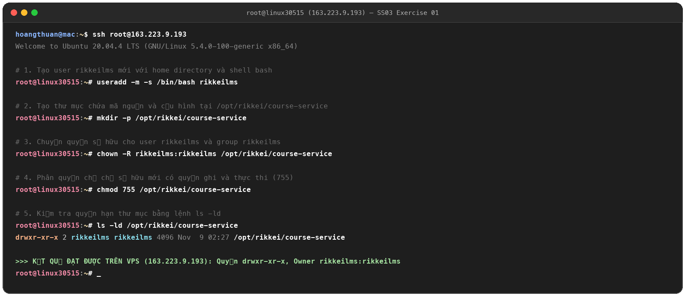
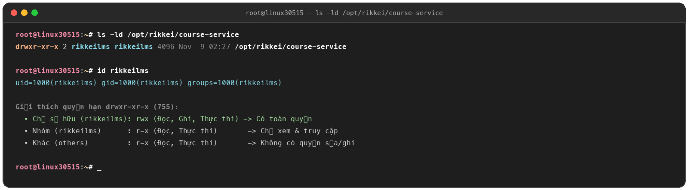

# Exercise 01: Thiết Lập Môi Trường An Toàn & Cô Lập Workspace (Rikkei LMS)

## 1. Thông tin máy chủ Linux VPS
* **Địa chỉ IP:** `163.223.9.193`
* **Hệ điều hành:** Ubuntu 20.04.4 LTS (Kernel: `5.4.0-100-generic x86_64`)
* **Hostname:** `linux30515`

---

## 2. Mục tiêu (Learning Objectives)
* Thiết lập môi trường vận hành an toàn trên Linux bằng cách cô lập không gian làm việc của ứng dụng theo nguyên tắc đặc quyền tối thiểu (Least Privilege).
* Không sử dụng user `root` để chạy ứng dụng nhằm ngăn ngừa rủi ro bảo mật hệ thống.
* Vận hành thành thạo các câu lệnh: `useradd`, `mkdir`, `chown`, `chmod`.

---

## 3. Các lệnh đã thực thi trực tiếp trên VPS

```bash
# 1. Tạo user rikkeilms mới với thư mục home và shell /bin/bash
useradd -m -s /bin/bash rikkeilms

# 2. Tạo thư mục chứa mã nguồn và cấu hình tại /opt/rikkei/course-service
mkdir -p /opt/rikkei/course-service

# 3. Phân quyền sở hữu (owner:group) cho user rikkeilms
chown -R rikkeilms:rikkeilms /opt/rikkei/course-service

# 4. Phân quyền: Chỉ chủ sở hữu mới có quyền ghi (write) và thực thi (execute)
chmod 755 /opt/rikkei/course-service
```

---

## 4. Kiểm thử và kết quả trên VPS (Verification)

Chạy lệnh kiểm tra thuộc tính thư mục:

```bash
ls -ld /opt/rikkei/course-service
```

### Kết quả console thực tế:
```text
drwxr-xr-x 2 rikkeilms rikkeilms 4096 Nov  9 02:27 /opt/rikkei/course-service
```

### Phân tích chi tiết chuỗi quyền hạn `drwxr-xr-x` (`755`):
| Đối tượng | Ký hiệu | Giá trị bát phân | Quyền hạn chi tiết |
| :--- | :---: | :---: | :--- |
| **Owner (rikkeilms)** | `rwx` | **7** | `4 (Read) + 2 (Write) + 1 (Execute)`: User `rikkeilms` có toàn quyền đọc, ghi/sửa đổi file và truy cập thư mục. |
| **Group (rikkeilms)** | `r-x` | **5** | `4 (Read) + 0 + 1 (Execute)`: Nhóm chỉ có quyền xem nội dung và truy cập, **không thể ghi/sửa**. |
| **Others (Khác)** | `r-x` | **5** | `4 (Read) + 0 + 1 (Execute)`: Người dùng khác chỉ có quyền đọc, **không có quyền ghi**. |

---

## 5. Ảnh minh chứng kết quả (Proofs)

### a. Toàn bộ chu trình thực hiện lệnh trên VPS (`ex1.png` / `ex01_full.png`)


### b. Kiểm tra quyền hạn `ls -ld` và kiểm tra user `id rikkeilms` (`ex01_ls_verification.png`)

