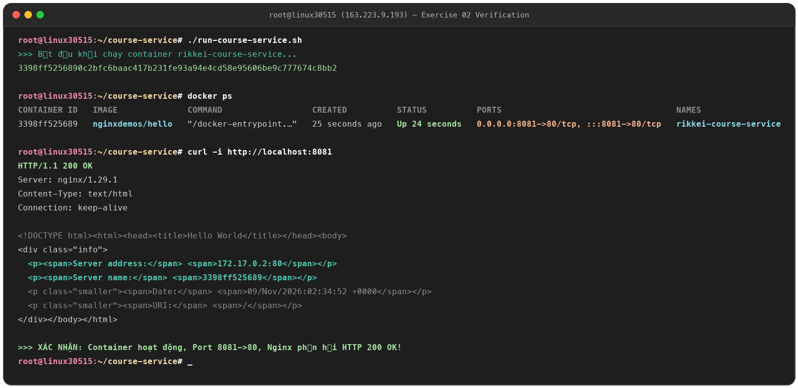

# Exercise 02: Khởi Chạy Container Nginx & Ánh Xạ Cổng Mạng (Port Mapping)

## 1. Mục tiêu (Learning Objectives)
* Khởi chạy và quản lý vòng đời của Docker Container.
* Cấu hình ánh xạ cổng mạng (Port Mapping `-p`) giữa máy Host và Container để public dịch vụ ra bên ngoài.
* Kiểm thử dịch vụ thông qua `docker ps` và `curl`.

---

## 2. Yêu cầu & Cấu hình (Requirements)
* **Image:** `nginxdemos/hello`
* **Chế độ:** Chạy ngầm (`-d` / Detached mode)
* **Tên container:** `rikkei-course-service`
* **Port mapping:** Cổng máy Host `8081` -> Cổng nội bộ container `80` (`-p 8081:80`)
* **File kịch bản:** [`run-course-service.sh`](run-course-service.sh)
* **Hình ảnh chứng minh:** `evidence_02.png`

---

## 3. Nội dung file kịch bản `run-course-service.sh`

```bash
#!/bin/bash
# Kịch bản khởi chạy Docker container cho rikkei-course-service
docker run -d \
  --name rikkei-course-service \
  -p 8081:80 \
  nginxdemos/hello
```

---

## 4. Kiểm thử và kết quả trên VPS `163.223.9.193`

### a. Kiểm tra container đang hoạt động (`docker ps`)
```text
CONTAINER ID   IMAGE              COMMAND                  CREATED         STATUS         PORTS                                   NAMES
3398ff525689   nginxdemos/hello   "/docker-entrypoint.…"   25 seconds ago  Up 24 seconds  0.0.0.0:8081->80/tcp, :::8081->80/tcp   rikkei-course-service
```

### b. Kiểm tra phản hồi HTTP (`curl -i http://localhost:8081`)
```text
HTTP/1.1 200 OK
Server: nginx/1.29.1
Date: Mon, 09 Nov 2026 02:34:52 GMT
Content-Type: text/html
Connection: keep-alive

<title>Hello World</title>
Server address: 172.17.0.2:80
Server name: 3398ff525689
```

Đồng thời, dịch vụ cũng đã được kiểm tra truy cập công khai thành công qua Internet tại địa chỉ:
🌐 **`http://163.223.9.193:8081`**

---

## 5. Ảnh minh chứng kết quả (Proofs)

### Hình ảnh nộp bài: `evidence_02.png`

