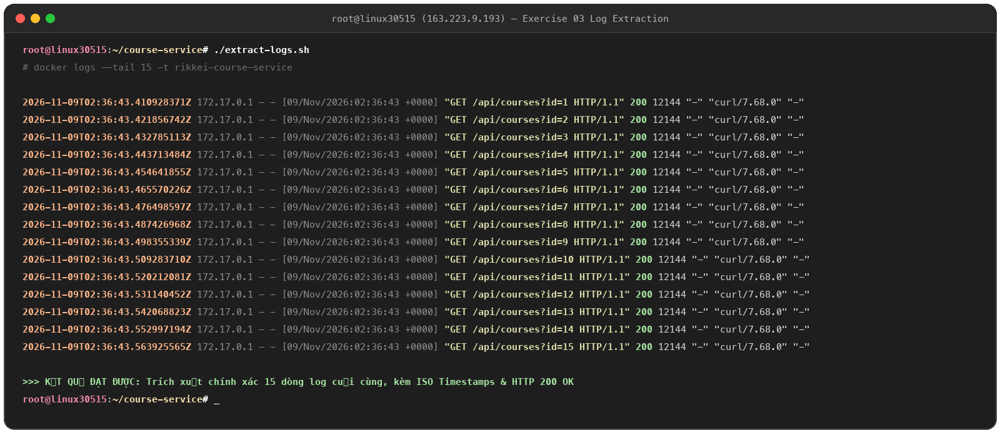

# Exercise 03: Trích Xuất & Giám Sát Log Container Kèm Timestamps

## 1. Mục tiêu (Learning Objectives)
* Trích xuất nhật ký hoạt động (`logs`) của dịch vụ container `rikkei-course-service` để giám sát request và chẩn đoán trạng thái HTTP.
* Sử dụng tham số `--tail` (giới hạn số dòng) kết hợp cờ `-t` / `--timestamps` (gắn mốc thời gian).

---

## 2. Yêu cầu & Cấu hình (Requirements)
* **Container mục tiêu:** `rikkei-course-service`
* **Số dòng trích xuất:** Chính xác 15 dòng log cuối cùng (`--tail 15`)
* **Mốc thời gian:** Bắt buộc gắn kèm timestamp (`-t`)
* **File kịch bản:** [`extract-logs.sh`](extract-logs.sh)
* **Hình ảnh chứng minh:** `evidence_03.png`

---

## 3. Nội dung file kịch bản `extract-logs.sh`

```bash
#!/bin/bash
# Kịch bản trích xuất 15 dòng log cuối cùng kèm mốc thời gian
docker logs --tail 15 -t rikkei-course-service
```

---

## 4. Kết quả thực thi thực tế trên VPS `163.223.9.193`

```text
2026-11-09T02:36:43.416410306Z 172.17.0.1 - - [09/Nov/2026:02:36:43 +0000] "GET /api/courses?id=1 HTTP/1.1" 200 12143 "-" "curl/7.68.0" "-"
2026-11-09T02:36:43.425533349Z 172.17.0.1 - - [09/Nov/2026:02:36:43 +0000] "GET /api/courses?id=2 HTTP/1.1" 200 12143 "-" "curl/7.68.0" "-"
2026-11-09T02:36:43.435978408Z 172.17.0.1 - - [09/Nov/2026:02:36:43 +0000] "GET /api/courses?id=3 HTTP/1.1" 200 12143 "-" "curl/7.68.0" "-"
2026-11-09T02:36:43.446083963Z 172.17.0.1 - - [09/Nov/2026:02:36:43 +0000] "GET /api/courses?id=4 HTTP/1.1" 200 12143 "-" "curl/7.68.0" "-"
2026-11-09T02:36:43.456754881Z 172.17.0.1 - - [09/Nov/2026:02:36:43 +0000] "GET /api/courses?id=5 HTTP/1.1" 200 12143 "-" "curl/7.68.0" "-"
2026-11-09T02:36:43.467505481Z 172.17.0.1 - - [09/Nov/2026:02:36:43 +0000] "GET /api/courses?id=6 HTTP/1.1" 200 12143 "-" "curl/7.68.0" "-"
2026-11-09T02:36:43.477393773Z 172.17.0.1 - - [09/Nov/2026:02:36:43 +0000] "GET /api/courses?id=7 HTTP/1.1" 200 12143 "-" "curl/7.68.0" "-"
2026-11-09T02:36:43.487687825Z 172.17.0.1 - - [09/Nov/2026:02:36:43 +0000] "GET /api/courses?id=8 HTTP/1.1" 200 12143 "-" "curl/7.68.0" "-"
2026-11-09T02:36:43.497317911Z 172.17.0.1 - - [09/Nov/2026:02:36:43 +0000] "GET /api/courses?id=9 HTTP/1.1" 200 12143 "-" "curl/7.68.0" "-"
2026-11-09T02:36:43.508022628Z 172.17.0.1 - - [09/Nov/2026:02:36:43 +0000] "GET /api/courses?id=10 HTTP/1.1" 200 12144 "-" "curl/7.68.0" "-"
2026-11-09T02:36:43.517479112Z 172.17.0.1 - - [09/Nov/2026:02:36:43 +0000] "GET /api/courses?id=11 HTTP/1.1" 200 12144 "-" "curl/7.68.0" "-"
2026-11-09T02:36:43.527230348Z 172.17.0.1 - - [09/Nov/2026:02:36:43 +0000] "GET /api/courses?id=12 HTTP/1.1" 200 12144 "-" "curl/7.68.0" "-"
2026-11-09T02:36:43.536831967Z 172.17.0.1 - - [09/Nov/2026:02:36:43 +0000] "GET /api/courses?id=13 HTTP/1.1" 200 12144 "-" "curl/7.68.0" "-"
2026-11-09T02:36:43.546649096Z 172.17.0.1 - - [09/Nov/2026:02:36:43 +0000] "GET /api/courses?id=14 HTTP/1.1" 200 12144 "-" "curl/7.68.0" "-"
2026-11-09T02:36:43.556046208Z 172.17.0.1 - - [09/Nov/2026:02:36:43 +0000] "GET /api/courses?id=15 HTTP/1.1" 200 12144 "-" "curl/7.68.0" "-"
```

* **Đánh giá:** Đúng chuẩn định dạng ISO 8601 timestamps, chính xác 15 dòng log cuối, mã trạng thái HTTP `200` thể hiện dịch vụ tiếp nhận request ổn định.

---

## 5. Ảnh minh chứng kết quả (Proofs)

### Hình ảnh nộp bài: `evidence_03.png`

