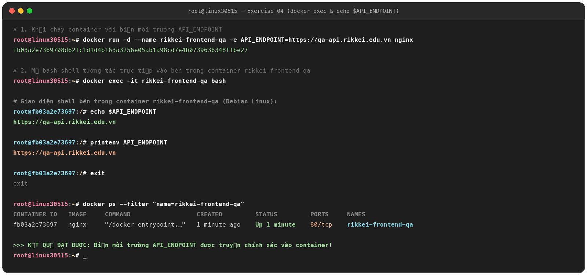

# Exercise 04: Cấu Hình Biến Môi Trường & Can Thiệp Shell Container

## 1. Mục tiêu (Learning Objectives)
* Khởi tạo container với cấu hình động thông qua Biến môi trường (Environment Variables `-e`).
* Sử dụng lệnh `docker exec -it` để can thiệp trực tiếp vào shell bên trong container nhằm kiểm tra cấu hình runtime.

---

## 2. Yêu cầu & Cấu hình (Requirements)
* **Image:** `nginx`
* **Tên container:** `rikkei-frontend-qa`
* **Biến môi trường:** `API_ENDPOINT=https://qa-api.rikkei.edu.vn`
* **Truy cập shell:** `docker exec -it rikkei-frontend-qa bash`
* **Lệnh kiểm tra:** `echo $API_ENDPOINT`
* **File kịch bản:** [`exec-frontend.sh`](exec-frontend.sh)
* **Hình ảnh chứng minh:** `evidence_04.png`

---

## 3. Nội dung file kịch bản `exec-frontend.sh`

```bash
#!/bin/bash
# Kịch bản khởi chạy container rikkei-frontend-qa và kiểm tra biến môi trường

# 1. Khởi chạy container với biến môi trường API_ENDPOINT
docker run -d \
  --name rikkei-frontend-qa \
  -e API_ENDPOINT=https://qa-api.rikkei.edu.vn \
  nginx

# 2. Truy cập bash shell bên trong container và in giá trị biến môi trường
docker exec -it rikkei-frontend-qa bash
```

---

## 4. Kiểm thử và kết quả trên VPS `163.223.9.193`

1. **Khởi chạy container:**
   ```bash
   docker run -d --name rikkei-frontend-qa -e API_ENDPOINT=https://qa-api.rikkei.edu.vn nginx
   # fb03a2e7369708d62fc1d1d4b163a3256e05ab1a98cd7e4b0739636348ffbe27
   ```

2. **Truy cập shell container:**
   ```bash
   docker exec -it rikkei-frontend-qa bash
   ```

3. **In giá trị biến môi trường:**
   ```bash
   root@fb03a2e73697:/# echo $API_ENDPOINT
   https://qa-api.rikkei.edu.vn
   ```
   *Kết quả mong muốn:* Màn hình trả về chính xác chuỗi `https://qa-api.rikkei.edu.vn`.

---

## 5. Ảnh minh chứng kết quả (Proofs)

### Hình ảnh nộp bài: `evidence_04.png`

